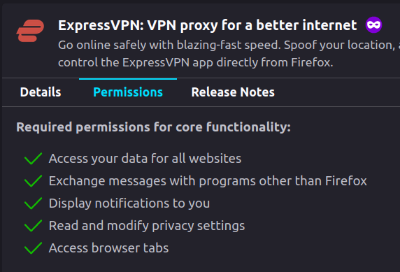
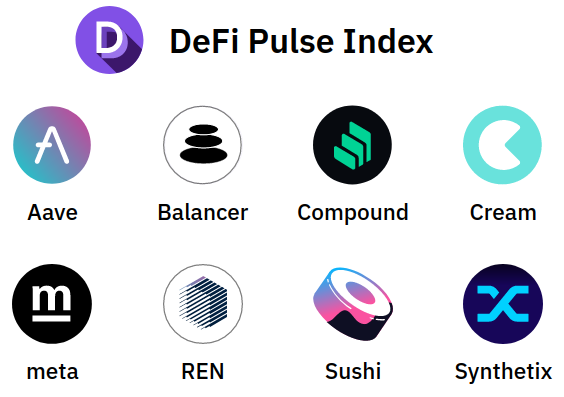
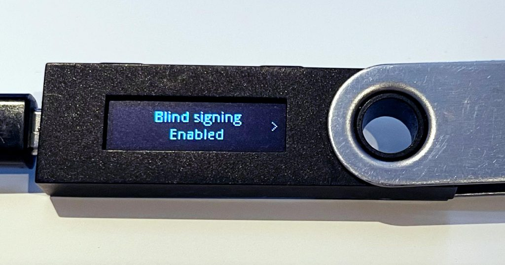
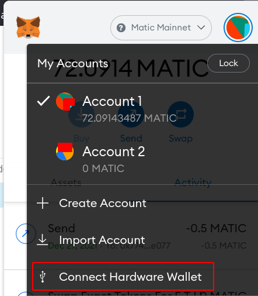
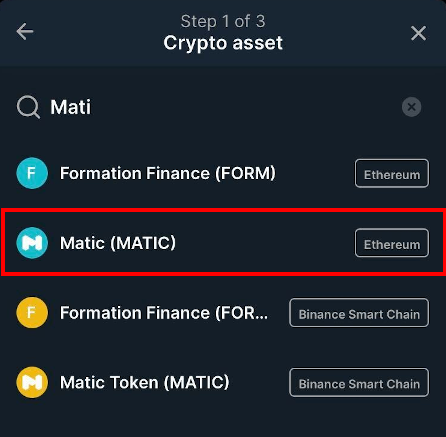
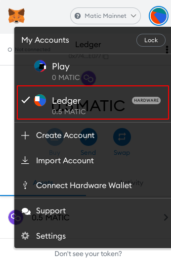

Metamask a beau être l'application standard pour découvrir le vrai web3,
 elle cache un problème de sécurité majeur qui peut détruire tous vos fonds. Ledger le résout.

-----

Note : ceci n'est ni une publicité pour Ledger, ni un article payé. Vous pouvez remplacer Ledger par [Trezor](https://trezor.io/).

## Les étapes de la découverte crypto

La première étape pour découvrir les cryptomonnaies est d'en acheter sur un exchange centralisé comme Binance ou Kraken.
Mais vous ne comprendrez la puissance de la blockchain qu'une fois que vous aurez des tokens dans un wallet comme Metamask.
Si ce n'est pas encore fait, essayez !

## Les dangers pour votre système de fichiers

Si vous avez une somme conséquente, il est temps de passer à un hard wallet. Pourquoi ?

Si un attaquant accède au système de fichiers de Metamask, il récupère vos clés privées et vous perdez tous vos fonds ☠️.

Je dis souvent que le web est l'endroit le plus sûr, et que vous n'avez pas besoin d'antivirus. Si vous ne faites rien de stupide, vous êtes probablement tranquille.

Ce n'est pas tout à fait vrai. D'abord, vous êtes peut-être plus bête que moi 😁, et j'ai moi-même été assez bête, une fois, pour donner mon numéro de carte bancaire à une page de phishing.

Si vous êtes codeur, ou si vous utilisez un outil professionnel, un plugin malveillant ou une dépendance open source peuvent avoir un accès étendu au système de fichiers. Ça arrive parfois quand un développeur open source confie son projet à un contributeur sympathique. Ce gentil contributeur est l'attaquant. Il publie une mise à jour malveillante, et vous lui faites confiance.

Une extension Chrome peut aussi [lire votre système de fichiers](https://stackoverflow.com/a/44948662/968988). Connaissez-vous toutes les permissions de vos extensions Chrome ?

Par exemple, les permissions de mon extension VPN sont plutôt généreuses :

### La bonne protection : passer à Ledger

Si votre système de fichiers est compromis, les clés privées stockées dans Metamask seront volées et vos actifs perdus.

Ledger apporte deux avantages majeurs :

- Il garde votre clé privée loin d'Internet
- Sa surface d'attaque est très, très faible, ce qui est essentiel

Ces dernières années, Ledger n'a connu que [quelques problèmes de sécurité mineurs](https://donjon.ledger.com/lsb/). Certains diront qu'il est si peu pratique qu'il réduit les attaques, puisque vous utiliserez peu les possibilités de la DeFi. Ce n'est pas totalement faux.

### Quand utiliser Ledger ?

Gardez Metamask comme porte-monnaie pour le quotidien et les expériences, et le compte Ledger pour votre épargne à moyen et long terme. Vous n'avez pas envie de toucher au Ledger trop souvent, car il demande quelques clics pénibles sur l'appareil.

Par exemple, j'utilise Metamask pour mon farming à 400 % d'APY sur Elrond, que je récolte presque tous les jours. Sur mon compte Ledger, je farme un montant plus important à 20 % sur de l'USDC/USDT, que je peux récolter tous les trimestres. J'ai aussi mis sur le Ledger mes [ETF Index Coop](https://www.indexcoop.com/dpi.html) et mes tokens natifs [StakeDAO](https://app.stakedao.org/0x452c075125F04582771C0A420B80218894754991/strategies) : il n'y a plus qu'à attendre.

### Ledger avec Metamask et la DeFi

Ledger n'a pas été conçu pour la DeFi, mais pour recevoir et stocker des tokens natifs. Avant d'interagir avec des smart contracts, vous devez autoriser le Blind Signing pour chaque token que vous utilisez.

Et il faut recommencer à chaque mise à jour 😐.

Il y a aussi un vrai **problème agaçant avec les autres EVM**, comme Polygon ou Celo. Vous ne voyez pas vos actifs tant que vous n'avez pas relié votre Ledger à Metamask.

Ledger vous donne la même adresse sur toutes les chaînes EVM, comme Ethereum, Polygon, Fantom, Celo, Avalanche... Mais début 2022, vous ne voyez que les tokens de la chaîne Ethereum.

Pas bon ! On est sur la chaîne Ethereum.

La documentation n'est vraiment pas bonne, et on trouve sur YouTube des tutoriels qui [envoient des MATIC](https://youtu.be/TaFjuk1rQa0?t=148) sur la chaîne Ethereum, avec 20 $ de frais de transaction 😕

Ce qu'il faut faire, c'est **connecter votre Ledger comme hardware wallet à un Metamask classique**. Vous obtenez ainsi un autre compte dans Metamask, à l'adresse de votre Ledger. Dans Metamask, vous pouvez alors basculer facilement sur Polygon et voir votre argent sur le compte Ledger.

### Prochaine étape : mettre votre Ledger à la banque

Si vous avez plus de 20 k$ sur votre Ledger, rendez service à la sécurité de tous : mettez votre Ledger dans une banque. Des [enlèvements violents](https://coconuts.co/hongkong/news/crypto-trader-kidnapped-beat-by-gang-demanding-hk30-million-ransom/) ont été signalés ici et là, et nous ne voulons pas que cela devienne courant. Faites savoir qu'il n'y a pas grand-chose à gagner.

Ma règle personnelle : moins de 5 k$ dans Metamask. Si ça monte, j'envoie le surplus à la banque.

Un coffre à la banque coûte environ 100 $ par an. Votre Ledger sera encore moins pratique à utiliser, mais pour l'essentiel de vos actifs à long terme, ça devrait aller.

Grâce à la magie des smart contracts avec proxy, le compte Ledger pourrait farmer et envoyer les gains vers le compte Metamask. C'est encore à développer, mais ça arrivera sûrement bientôt 😊
