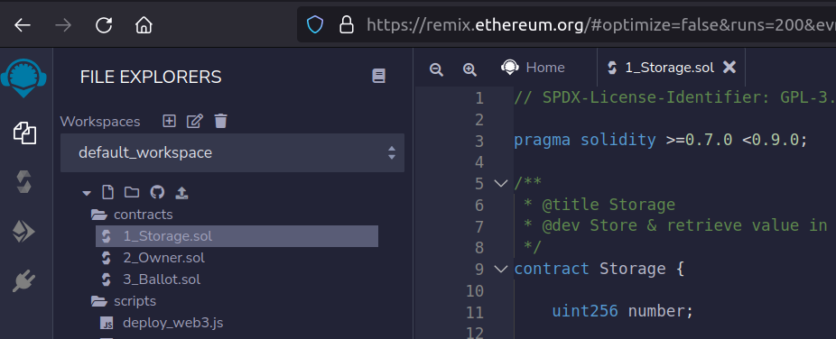
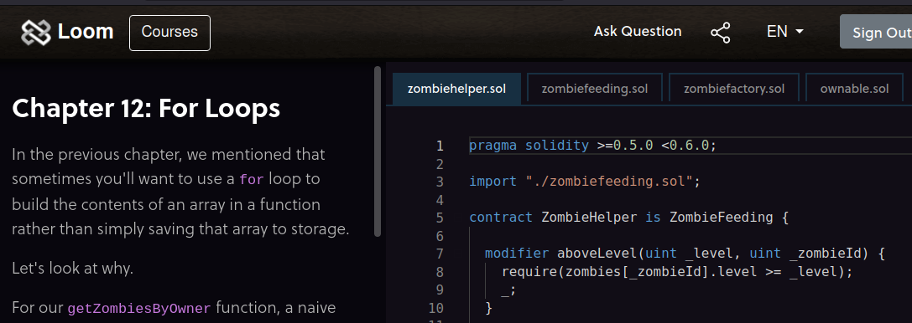
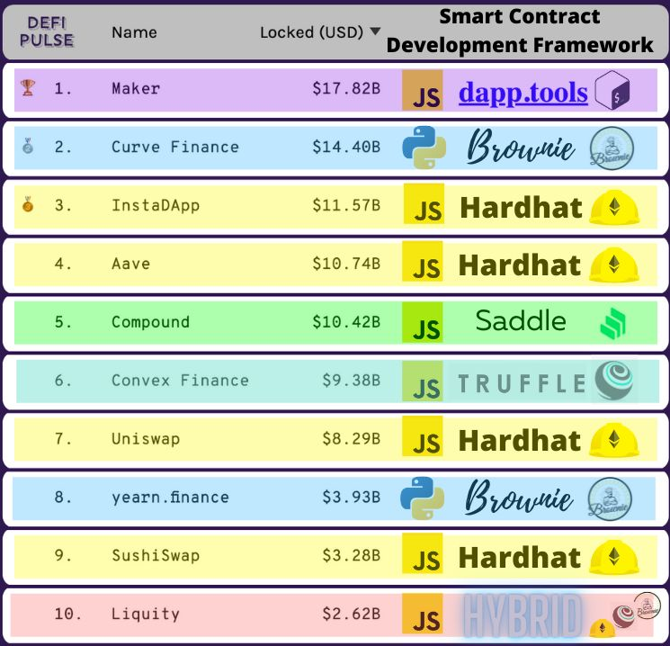

Mettez en place au plus vite un environnement professionnel pour apprendre à coder sur le web3.

-----


Cet article explique aux développeurs *classiques* comment installer un environnement local pour coder, tester et déployer
sur des blockchains de type Ethereum. Je vous donne quelques bonnes pratiques et des ressources web utiles, pour démarrer
votre aventure Web3 confortablement.

TL;DR : regardez cette vidéo [Truffle beginners](https://www.youtube.com/watch?v=62f757RVEvU)
d'EatTheBlocks.

Par où commencer
----

Vous pouvez démarrer très vite avec [Remix IDE](https://remix.ethereum.org). C'est un outil en ligne. J'ai pu déployer
[mon premier token (RBTA)](https://bscscan.com/address/0x5eA1866F3b2c5EA4baBE9C5DB2F920CB9968560E)
avec. C'est un shitcoin de plus, mais vous pouvez en acheter pour me laisser un pourboire 😊

Pour déployer le token RBTA, j'ai suivi ce tutoriel [d'Ivan on Tech](https://www.youtube.com/watch?v=h4gQD7R1r94&t=298s)



Vous pouvez aussi apprendre Solidity et web3js avec [Cryptozombies](https://cryptozombies.io/en). C'est d'ailleurs assez poussé, mais sans
créativité : il faut taper exactement la bonne ligne.




Utiliser un IDE local
----

Remix, c'est amusant une journée, mais vous voulez vos fichiers dans un outillage solide. Vous coderez du Solidity, mais aussi
du React ou du Vue pour le web, et vous voulez sans doute garder vos outils préférés.

Fan de JetBrains, j'ai ajouté le plugin Solidity soutenu par JetBrains. Il a apporté quelques bugs, j'ai dû le désinstaller puis le réinstaller. C'est
assez inhabituel... mais c'est arrivé.


Utiliser Truffle
-----

Truffle est un framework d'outillage. Vous disposez d'un ensemble d'outils préconfigurés, sans
ajouter leur code.

Installez-le avec `yarn add truffle`. J'éviterais de l'installer globalement, pour maîtriser exactement la version. Dans
ce cas, vous taperez `node_modules/.bin/truffle` au lieu de `truffle` tout court ; les pros de npm trouveront des astuces sur le web.

Vous pourrez :

- compiler votre code et créer les contrats : `truffle compile`
- tester automatiquement vos contrats : `truffle test`
- déployer les contrats :
    * `truffle develop` démarre la chaîne et ouvre une console
    * `truffle migrate --reset` redéploie tous les contrats

L'équipe d'[EatTheBlocks](https://eattheblocks.com/) produit d'excellents contenus sur le code Solidity. Voici celui
sur [Truffle pour débutants](https://www.youtube.com/watch?v=62f757RVEvU). Cette vidéo est indispensable !


Utiliser Ganache
----

Ganache est un outil qui fait tourner une blockchain Ethereum avec plein d'options. Truffle utilise Ganache en
coulisses, mais savoir le piloter soi-même est utile. Nous sommes codeurs, nous utiliserons donc la version CLI 😁.

Installez-le avec `yarn add ganache-cli`. Comme pour Truffle, évitez l'installation globale.

-  `ganache-cli` : démarre une toute nouvelle blockchain
-  `ganache-cli -db "./db-path" -m "bread car ... color"` : démarre une blockchain persistante avec des comptes définis

Voici la [vidéo Ganache d'EatTheBlocks](https://www.youtube.com/watch?v=AS2_uPSTk5E).


Tests et mocks
-----

Tester un contrat Solidity est assez simple. Il y a toutefois un problème majeur. On veut souvent **injecter une
adresse** (celle de l'oracle dans mon cas), et seul le propriétaire du contrat doit pouvoir le faire. Mais pendant qu'on code,
on ne connaît pas encore l'adresse du propriétaire.

L'idée est d'écrire un contrat mock. J'écris un fichier MockCodeFan.sol, copie du `CodeFan.sol` final, en
ajoutant ces lignes à la fin :

```solidity
contract MockCodeFan {

    // might be constant
    address  private  OWNER = 0xf17f52151EbEF6C7334FAD080c5704D77216b732;
    address  private  ORACLE = 0xf17f52151EbEF6C7334FAD080c5704D77216b732;
    
    function setOracle(address oracle) public{
      require(msg.sender == OWNER);
      ORACLE = oracle;
    }
    // ....
    /**
    * TESTABLE FUNCTIONS and events - Should be deleted in deployment
    */
    function setOwner(address owner) public{
        OWNER = owner;
    }

    event Debug(address  _from, string  domain);

}
```

Dans le test, je peux alors commencer par

```js

  let [johndoe, nik, oracle  ] = accounts;
  await contract.setOwner(nik);
  await contract.setOracle(oracle, {from: nik});

```


Débugger
-----

Maintenant que vous avez du code Solidity, vous voulez comprendre ce qui se passe avant d'envoyer des millions dans le contrat. Mais
il n'y a ni `console.log()` ni débogueur à attacher en Solidity 🤷. Difficile de savoir ce qui se passe
dans la machine.

La technique consiste à créer un événement Debug et à l'écouter pendant les tests.

```solidity
    event Debug(address  _from, string  domain);

    function addSite(address  user, string calldata domain) external {
        emit Debug(user, domain);
        require(msg.sender == ORACLE);
        // ...
    }
```

Pour simplifier, j'ai utilisé la bibliothèque [truffle-assertions](https://github.com/rkalis/truffle-assertions) :

```js
const truffleAssert = require('truffle-assertions');
result = await contract.addSite(oracle, domainNames[0],
    {from: oracle});
// -> will display the event
truffleAssert.prettyPrintEmittedEvents(result); 
```

Et ensuite
----

J'ai utilisé **Remix** pour déployer mon premier token, **Truffle** pour mes premiers vrais projets. Et je vais sans doute bientôt essayer [Hardhat](https://hardhat.org/).

La raison principale : on peut utiliser `console.log()` directement dans le code Solidity (wow 😁), et 0xGorilla a créé
[Smock](https://github.com/defi-wonderland/smock), un plugin de mock pour Hardhat. Preuve que Hardhat peut être bien plus flexible que
Truffle. Mais comme il propose beaucoup d'options et de plugins avant même de commencer, je ne démarrerais pas directement avec.

Voici le tableau d'adoption des outils chez les grandes entreprises du web3


