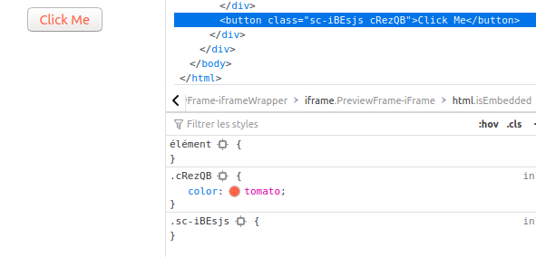
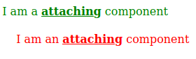

Styled Components est une technologie qui fait passer le CSS à l'échelle. C'est très bien, mais il y a quelques
pièges. Voici ce que j'aurais le plus aimé savoir en débutant avec Styled Components.

---

## Objectifs et difficultés


**Styled Components** est une bibliothèque écrite par l'impressionnant Max Stoiber, et maintenue aujourd'hui
 par de nombreux autres contributeurs, preuve de succès et de pérennité.
 
Selon moi, il y a deux objectifs principaux.

- Passer à l'échelle en évitant l'enfer du BEM, avec des noms de classes comme `search-box__btn search
-box__btn_max_visible` 
- Protéger votre composant de la cascade du CSS. Oui. Casser le <b>C</b> de CSS


Comme on peut s'y attendre, ce second objectif peut faire un peu mal, ou au moins surprendre quand, comme moi,
 on est trop naïf.
 
 
### Exemple rapide


Commençons par un exemple [tiré de la doc](https://styled-components.com/docs/basics#extending) :

```jsx
const Button = styled.button`
  color: palevioletred;
`;

const TomatoButton = styled(Button)`
  color: tomato;
`;
```

Ça fonctionne et donne deux jolis boutons. Mais avec :

```jsx
const MyButton = ()=><button>Click Me</button>

const MyTomatoButton = styled(MyButton)`
  color: tomato;
`;
```

Je suis naïf et j'ai un bouton. Je veux le styler, alors j'écris `styled(button)`.
Mais mon nouveau bouton n'a aucune couleur tomate 😞

### Lire le manuel

D'abord, soyez plus malin que moi et ne ratez pas cette ligne, la plus importante [du manuel](
https://styled-components.com/docs/basics#styling-any-component) :

> La méthode styled fonctionne parfaitement sur tous vos composants et ceux de tiers, **tant
> qu'ils attachent la prop className** reçue à un élément du DOM.

```jsx
const Link = ({ className, children }) => (
  <a className={className}>
    {children}
  </a>
);
```

 
Pourquoi ? Parce que les exemples qu'on trouve sur le web, y compris dans la documentation de Styled Components,
donnent l'impression qu'il est facile de modifier un composant, alors que ce second objectif vise
<b>exactement</b> à éviter toute modification d'un composant.


## Appliquer les classes

Le problème est que styled(Comp) n'a d'effet que si Comp est déjà un styled component.
Pour y arriver, il faut ajouter le `className` à MyButton


```jsx
const MyStyledButton = ({className})=><button className={className}>Click Me</button>

const MyTomatoButton = styled(MyStyledButton)`
  color: tomato;
`;
```

Styled Components crée alors des classes et les applique à votre composant, ce qui en fait un styled
 component.
 

 
*Pas de className, pas de style*. Avec `styled.div`, Styled Components a déjà appliqué
l'astuce du `className`.

C'est un comportement voulu. Vous n'êtes pas censé transformer un composant, sauf si
son créateur vous l'a explicitement permis ! C'est le
[principe ouvert/fermé](https://en.wikipedia.org/wiki/Open%E2%80%93closed_principle)
appliqué au style.

## Usage avancé


### Restyler

Une fois un composant stylé, vous pouvez le restyler.

```jsx
const AttachingComp = ({className})=><div className={className}>I am a <strong>attaching</strong> component</div>

const GreenAttachingComp= styled(AttachingComp)`
  color:green;
  strong{
    text-decoration:underline
  }
`

const Child = styled(GreenAttachingComp)`
   margin: 20px 20px;
   color: red;
`

```



### Imbriquer des composants

Le même comportement *fermé par défaut* s'applique aux composants imbriqués. Si vous
n'avez pas appliqué `className` à un élément React, les règles d'imbrication ne... s'appliquent pas.

```jsx

const BasicComp = () => <div>I am a <strong>basic </strong>component</div>;

const AttachedComp = ({ className }) => (
  <div className={className}>
    I am an <strong>attached</strong> component
  </div>
);

const StyledBasicComp = styled(BasicComp)``;
const StyledAttachedComp = styled(AttachedComp)``;


const DemoNesting = ({className})=>{
  return (
    <div className={className}>
      <StyledBasicComp/>
      <StyledAttachedComp/>
    </div>
)}


export const StyledDemoNesting = styled(DemoNesting)`
// general css rules. Will be applied to all nodes below
font-size:12px;
strong{
  color:red;
}


// component rule on basic component. Won't be effective
${StyledBasicComp}{
  color:yellow;
}

// component rule on className attached component. Rule is effective
${StyledAttachedComp}{
  color:green;
  font-size:24px;
}
`
```

Vous pouvez le tester dans ce [Stackblitz](https://stackblitz.com/edit/styled-components-robusta?file=nesting.js)

 
## Quand attacher className ?

Le plus souvent, il ne faut pas. C'est conçu ainsi. Si vous avez peu de règles, préférez
 le CSS standard ou Sass.
   
Dans une application plus grosse, attacher `className` peut multiplier les interférences.

Si vous voulez présenter un composant de plusieurs façons, utilisez plutôt un [thème](https://styled-components.com/docs/advanced#theming)
 ou des [props passées](https://styled-components.com/docs/basics#passed-props) si cela passe par l'état de votre application.
 
Attacher `className` est vraiment prévu pour le cas où vous créez une bibliothèque tierce et
 concevez un point d'extension. Vous ouvrez explicitement le composant au style. Attacher le
  `className` évitera certains hacks, comme ceux décrits [dans cette issue](https://github.com/styled-components/styled-components/issues/2076).
  
J'attache plus ou moins `className` pour créer ma propre bibliothèque. Je conçois des composants de thème, comme
 `TCard`, puis j'en modifie l'espacement à différents endroits de ce site Gatsby, ou je les réutilise pour des
  sites similaires.

Pour l'instant, ce n'est qu'un essai, et ça a l'air de bien marcher. Mais il m'a fallu beaucoup trop de temps pour vraiment
 comprendre comment et pourquoi attacher `className`. Peut-être que cet article vous aidera 😊
