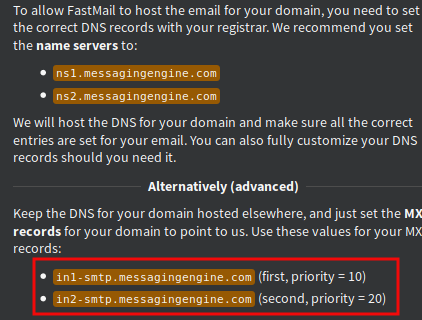
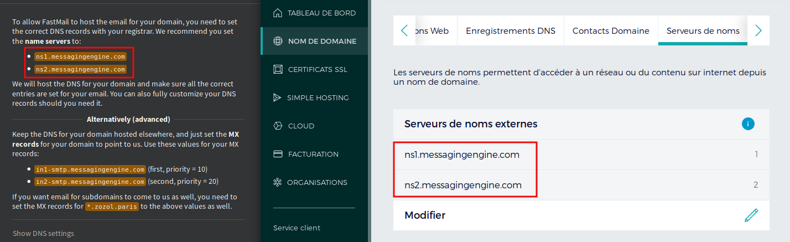
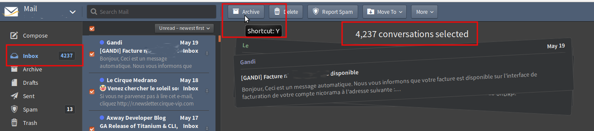

Gmail était une révolution en 2004. Google est-il devenu trop gros ?

---

Pourquoi ?
----

Des milliers d'articles de blog donnent leur avis, voici le mien.

Confier ses données à Google était acceptable il y a quelque temps. Ça ne l'est plus. D'abord parce que Google a changé, en devenant aussi gros. Ensuite, et surtout,
parce que si vous trouvez Google encore acceptable aujourd'hui, il pourrait ne plus l'être demain. Soyez prêts.

Aujourd'hui comme demain, une adresse email représentera votre identité. Possédez-la.

Registrar
---

La première étape est de choisir un registrar pour votre domaine, comme l'excellent [http://www.gandi.net].
Choisissez un nom de domaine, comme `votrenom.fr` s'il est disponible et si vous êtes en France.
Si vous êtes attaché à votre ville et prêt à payer 45 €/an, `votrenom.paris` est une option sexy. Mais `votrenom.me` est le choix le plus courant, et bien moins cher.

Créez ensuite un compte Fastmail (ou ProtonMail, ou n'importe quoi qui ne soit pas Hotmail). Le premier vrai problème est qu'il faut modifier les réglages DNS,
pour que lorsqu'un email arrive sur `votrenom.me`, votre registrar puisse le renvoyer vers Fastmail.

On ne peut pas acheter directement un domaine chez Fastmail. Mais si un jour Fastmail ne vous convient plus, il sera extrêmement simple de partir en gardant la même identité.

Comme je suis un utilisateur avancé, j'ai préféré l'option avancée : utiliser les enregistrements MX de Fastmail, en gardant les autres enregistrements pour moi, notamment pour le site web associé.

Les enregistrements DNS sont très difficiles à comprendre, mais heureusement, les enregistrements MX qui gèrent la redirection des emails ne sont pas les pires.
Le principal problème est qu'il faut attendre des heures avant de savoir si l'enregistrement DNS est bon ou non. Et « des heures », ce n'est pas assez précis.

L'autre problème est que j'ai dû créer des boîtes mail chez Gandi, que le MX redirigeait ensuite vers Fastmail. Et ces boîtes sont limitées à deux. Ce n'est pas le métier de Gandi.

La méthode standard est donc la meilleure : indiquer à Gandi que les serveurs de noms ne sont pas sur les IP de Gandi, mais sur celles de Fastmail.

Importer ses emails
----

Il faut ensuite importer tous vos emails depuis Gmail. La principale difficulté est de désactiver la sécurité de Gmail après ce genre de message :

https://www.fastmail.com/help/account/gmailimport.html

>Alerte de sécurité critique : une application suspecte a été bloquée lors de l'accès à votre compte

Vous devez **temporairement** autoriser les [applications moins sécurisées](https://myaccount.google.com/lesssecureapps) dans votre compte Google.

Et n'oubliez pas de rétablir la sécurité après l'import. Votre compte Google doit rester protégé.

Oups
----

Gmail et Fastmail n'ont visiblement pas la même relation avec le mot **lu**. Je me suis retrouvé avec plus de 4000 messages
soi-disant non lus. C'est très simple à régler, mais ça demande un peu de courage : archivez-les.

