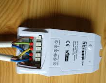
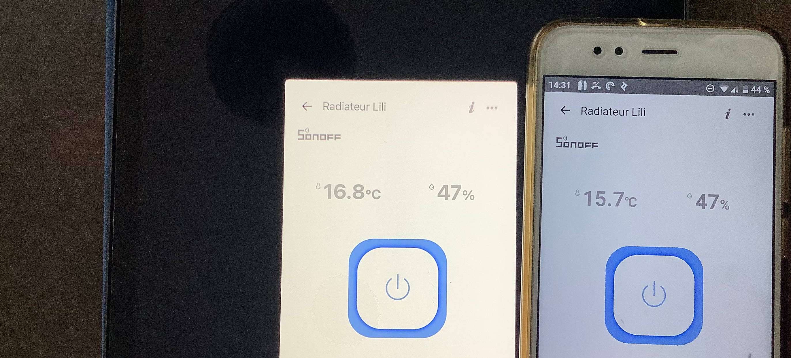
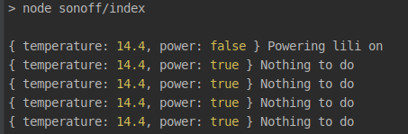

Allumez et éteignez votre vieux radiateur électrique avec du code. Un peu de Javascript suffit pour faire des économies et
réduire vos émissions de CO2.

---

## Sonoff

[Sonoff](https://amzn.to/39a54eI) est une entreprise qui fabrique des composants connectés bon marché (de 5 $ à 40 $), compatibles avec les logiciels de type IFTTT. Parmi les concurrents de Sonoff, on trouve d'abord [Shelly](https://amzn.to/38YKjm4), mais aussi [Horsky](https://amzn.to/3nnwva2), Kankun... Mais côté Javascript, je n'ai trouvé d'équivalent que pour [Kankun](https://www.npmjs.com/package/homebridge-smartplug), et il a été publié il y a trois ans. N'y comptez donc pas.

Cet article présente le [module npm ewelink de Skydiver](https://github.com/skydiver/ewelink-api), qui a parfaitement fonctionné du premier coup.

Comme je travaille sur le radiateur, j'ai acheté la version [TH-16](https://amzn.to/3bcx97P) : une capacité de 16 ampères, avec capteur de température, pour 15 $. Attention à bien utiliser le [capteur Sonoff TH Sensor-AM2301](https://amzn.to/38ihMc2), les autres capteurs ne fonctionnent pas aussi bien.



## eWeLink, IFTTT, Alexa...

Là, ça se gâte. Votre expérience sera peut-être différente, mais chez moi, ça ne fonctionne pas comme il faut. Pas question d'installer Alexa ou équivalent à la maison.

L'application eWeLink (Android ou iOS) est obligatoire : c'est elle qui permet à Internet de trouver votre appareil. Vous créez un compte eWeLink, et ils enregistrent votre appareil. Vous avez ensuite quelques options pour allumer et éteindre l'interrupteur, mais avec beaucoup de limites : soit il est piloté par une température min/max, soit par des déclencheurs horaires. À une heure donnée, il force `on` ou `off`. Ce n'est pas mal, mais ça ne suffit pas, et l'UX est médiocre.

Mon téléphone Android et mon iPad ont tous les deux eWeLink installé.



Vous comprenez pourquoi je ne veux pas m'appuyer sur l'application... Heureusement, les résultats que j'obtiens par le code sont plus cohérents.

IFTTT signifie IF This Then That. Ce n'est pas un protocole ouvert, plutôt un outil SaaS privé, un peu comme Zapier. Une [API HTTP](https://platform.ifttt.com/docs/api_reference) permet de contrôler les appareils. Elle est assez difficile à suivre, surtout pour accéder à l'appareil avec vos droits.

## Le code et l'installation

L'objectif est d'allumer le chauffage de la chambre de Lili selon quelques contraintes. Si la température est inférieure à 18 ET
que c'est le bon moment du bon jour, on allume. Sinon, on éteint.

J'ai simplement installé les packages ewelink-api et dotenv, ce dernier pour éviter les mots de passe en dur. Une partie du code, _fermée_, sert à parser les réponses d'ewelink.

```javascript
require('dotenv').config();
const ewelink = require('ewelink-api');

const devices = {
  lili: process.env.LILI,
};

const connection = new ewelink({
  email: process.env.EMAIL,
  password: process.env.PASSWORD,
  region: process.env.REGION, // eu, us ....
});

let intervalId;
connection
  .getDevices()
  .then(() => (intervalId = setInterval(work, 15 * 60 * 1000)));

async function work() {
  try {
    const { temperature, power } = await liliStatus();

    if (temperature < 18 && !power && timeAndDayToPowerOn()) {
      console.log({ temperature, power }, 'Powering lili on');
      await connection.setDevicePowerState(devices.lili, 'on');
    } else {
      if (power) {
        console.log({ temperature, power }, 'Powering lili off');
        await connection.setDevicePowerState(devices.lili, 'off');
      } else {
        console.log({ temperature, power }, 'Nothing to do');
      }
    }
  } catch (e) {
    console.error(e);
  }
}
```

C'est presque toute la logique nécessaire. Plus de détails sur [ce gist](https://gist.github.com/nicolas-zozol/1f06ec0822c32b5e4ce30ffaba09947a), qui améliorera sans doute ce code.

## Jusqu'ici, tout va bien.

L'appareil est loin de la box wi-fi, mais il fonctionne quand même.



Prochaine étape : déployer tout ça sur [Clever Cloud](https://www.clever-cloud.com/en/) ou équivalent. Ou bien retirer la boucle de `setInterval` et lancer une [GCP Function](https://cloud.google.com/functions) (une lambda) avec un [cron](https://cloud.google.com/scheduler).

Anecdote : si vous gardez `setInterval` dans votre Cloud Function, vous risquez de payer des milliers de dollars de lambdas empilées.

Les instructions ne sont pas stockées sur l'appareil lui-même. Il attend des ordres extérieurs pour passer `on`/`off`. Je devrais faire des économies, mais
le problème, c'est que le chauffage dépendra du temps qu'il fait, et désormais aussi des nuages du cloud.
